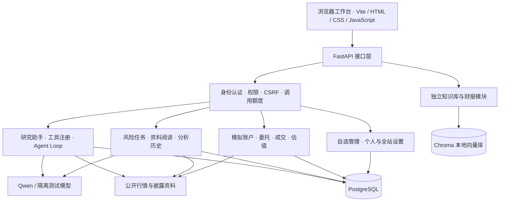

# TURAQ · A 股智能研究平台

将行情观察、资料研究、风险分析与模拟交易放在同一个工作台中。

## 项目介绍

TURAQ 是一个面向个人 A 股研究场景的全栈 AI 应用。项目以自选股票为研究对象，结合公开行情、上市公司公告与财报、结构化风险记录和模拟账户，支持从“关注一只股票”到“查阅资料、理解风险、模拟操作、观察结果”的研究流程。

平台采用 FastAPI 与 PostgreSQL 构建后端，使用原生 HTML、CSS、JavaScript 和 Vite 构建浏览器工作台，并接入 Qwen 模型完成自然语言理解、工具选择和资料解读。价格计算、指标统计、权限校验与模拟成交由服务端程序处理；模型生成的解释与数据来源、未知信息分别展示。

这个项目同时也是一份 AI Agent 工程实践作品：从后端接口与数据库出发，逐步实现工具注册、参数校验、多轮 Agent Loop、执行审计、文档检索、任务恢复和用户确认机制。仓库保留每日学习记录、设计说明、测试与独立课堂示例，方便阅读实现过程和继续学习。

| 研究环节 | 平台提供的能力 |
| --- | --- |
| 建立关注范围 | 搜索证券、建立自选分组、管理股票列表 |
| 观察市场 | 指数与个股报价、分时图、日/周/月 K 线和复权切换 |
| 提出问题 | 自然语言研究、连续追问、股票对比与技术指标计算 |
| 查阅证据 | 公开公告与财报清单、PDF 原文读取、页序与来源链接 |
| 整理风险 | 分组/单股分析任务、结构化结论、分析历史和跟踪状态 |
| 模拟操作 | 模拟账户、委托与成交、持仓估值、收益和风险指标 |
| 管理工作台 | 个人偏好、账号会话、模型配置、调用额度与管理审计 |

## 内容导航

- [功能介绍](#功能介绍)
- [典型使用流程](#典型使用流程)
- [技术架构](#技术架构)
- [本地运行](#本地运行)
- [API 与项目结构](#api-与项目结构)
- [测试与验证](#测试与验证)
- [学习计划与文档](#学习计划与文档)

## 功能介绍

### 1. AI 研究助手

研究助手支持金融概念解释、指定股票研究和基于当前对话的连续追问。后端根据问题选择工具，将真实执行结果回传模型，再组织最终回答；普通问答可以直接回复，无需每次套用固定报告模板。

当前工具注册表包含 **19 项只读研究能力**，覆盖：

- 股票名称与代码搜索、本地股票资料、公开报价和历史日线查询。
- 指数行情、分时走势、日/周/月 K 线及股票区间对比。
- 涨跌幅、均线、RSI、MACD、布林带、ATR、区间回撤与量价统计。
- 公告与财报清单、文档读取、关键词定位和来源原文对照。
- 综合市场风险参考判断，以及资料覆盖不足时的原因说明。

工具参数通过 Schema 校验，计算过程由 Python 执行。循环具有轮数上限、请求期限与调用额度，未知工具和执行异常会形成明确结果。页面以回答与必要来源为主，后台保留执行轨迹和审计记录。

模型模式由服务端配置控制：`fake` 用于隔离演示与测试，`qwen` 用于在线研究；关闭模型调用后仍可使用相应的非模型功能。隔离测试回答不代表真实模型分析，浏览器聊天上下文也不等同于长期记忆。

### 2. 行情工作台与自选管理

自选管理支持创建、重命名与删除分组，按名称或证券代码查找股票，添加和移除成员，并将选中的股票带入研究助手。分组及成员由后端按当前登录账号隔离。

行情工作台提供个股与指数报价、价格变化、成交量及图表查看。独立详情支持分时、日 K、周 K、月 K，以及不复权、前复权、后复权切换；图表提供十字线和成交量展示，方便观察价格与成交的对应关系。

自动刷新可以在设置中调整，页面隐藏或退出时暂停轮询。公开数据源不可用时保留已有数据并标记状态；返回数据的实际时间、复权口径和缺失情况与价格一起展示，证券目录本身不被视为实时行情。

### 3. 风险分析与资料阅读

风险工作台支持按全部自选、指定分组或单只股票发起研究任务，也支持搜索并选择自选范围外的股票。用户可以选择资料回溯范围，让服务端收集行情、历史日线及公开披露材料，并保存本次研究范围和输入快照。

分析过程包含资料采集、文档提取、阅读与汇总等阶段：

- 根据公开披露清单读取公告与定期报告，保留来源链接、文档标识和 PDF 文件页序。
- 对可提取的长文档文字连续分批阅读，保存阅读位置、已读字数和中间发现。
- 将程序统计、模型解读、未知项与原文证据分别组织，展示行情、财报和公告的实际覆盖情况。
- 持久化逐股状态与分析结果，支持取消、继续未完成项、查看历史版本和失败原因。
- 支持手动补充资料，按股票、风险类型、等级、资料日期和处理状态查找记录。
- 为事件标记“未查看”“已查看”或“持续关注”，并携带研究背景跳转到助手继续追问。

任务由打开的风险页面逐步推进；已开始的请求由后端处理并保存，尚未开始的项可在回到页面后继续。该流程按用户选择的范围工作，不等同于全天候后台持续扫描。文字提取不包含 OCR，市场风险参考评级也不代表已核验公司全部财务和公告风险。

### 4. 模拟交易与账户表现

模拟交易模块提供独立的模拟账户、资金、持仓、委托、成交和账户快照。用户可以配置初始资金与佣金参数，通过市价或限价委托观察交易规则和资金变化。

- 提交前查看报价、预计金额、费用和风险提示。
- 校验可用资金、可卖持仓、交易时段、手数、涨跌幅价格边界和 T+1 等实现规则。
- 支持限价委托等待匹配、撤单，以及资金冻结与释放。
- 按程序规则计算佣金、印花税、过户费、持仓成本和已实现盈亏。
- 查看账户净值、持仓估值、成交明细、收益曲线、最大回撤及基准对比。
- 将风险提示与用户确认关联，便于复盘一次模拟操作前后的背景。

资金和成交计算使用 `Decimal`。行情缺失或样本不足时保留未知状态；指标以已有观测为基础。模块只操作模拟账户，不连接券商或真实资金账户。

### 5. 知识库与财报分析模块

仓库包含独立的 RAG 知识库模块，支持文本、PDF、Word 文档解析、文本分块、向量化、Chroma 存储与语义检索。`knowledge/` 保存财务指标、交易规则、风险管理、行业分析和财报阅读等知识文档，可以通过脚本重新导入本地索引。

财报分析接口支持上传 PDF，尝试抽取资产、负债、营收、净利润、经营现金流等指标，计算财务比率，并结合规则和知识库生成风险说明。这个上传演示路径在 PDF 解析失败时会回退到固定样例数据，因此回退结果只能用于流程演示，不能作为上传财报的真实分析结论；它与公开披露原文阅读任务分别实现。

### 6. 账号、权限与管理后台

账号模块包含邮箱密码登录、邮箱链接登录、可选邀请码注册、邮箱验证、重发验证邮件及找回/重置密码。密码使用 Argon2 哈希保存，登录身份由后端 HttpOnly 会话 Cookie 提供。

写操作校验 Origin 与 CSRF，私有查询按用户身份限定。退出登录或切换账号会清除前端私有状态，旧请求的迟到响应不能恢复另一账号的数据。模型调用具有用户与站点额度、并发约束及期限控制。

管理员后台提供用户列表、账号状态管理、邀请码创建与维护、统计查看及全站配置入口。邀请码原码仅在创建时展示；后台统计区分工具执行记录与实际模型用量，不将缺失的费用数据当作真实账单。

邮件流程依赖实际 SMTP 配置。邮件服务未配置时，已有已验证账号仍可登录，相关邮件入口会显示配置状态；请求受理不代表邮件已经送达。

### 7. 系统设置

个人设置保存到当前账号，覆盖工作台、行情、研究、风险、模拟交易和会话管理等使用习惯。

| 设置范围 | 具体内容 |
| --- | --- |
| 工作台偏好 | 默认页面、界面密度、减少动画、自选排序 |
| 行情与图表 | 自动刷新、刷新间隔、默认图表周期与复权方式 |
| 研究与风险 | 发送快捷键、研究轮数、默认风险筛选与资料回溯范围 |
| 模拟交易 | 刷新方式、新账户资金与佣金默认值、委托默认类型 |
| 账号与安全 | 修改密码、查看有效会话、退出其他会话 |
| 管理员全站配置 | 模型供应商与名称、输出预算、额度、限流、处理超时及变更记录 |

设置支持保存、恢复默认、个人 JSON 导入与导出，并使用版本号检查防止旧页面覆盖新配置。管理员模型密钥更新使用服务端加密保存，响应、导出和审计不包含密钥原文。

## 典型使用流程

1. **登录并建立自选分组**：按研究主题整理股票，形成自己的观察范围。
2. **查看行情与图表**：确认数据时间、价格走势和当前选择的复权口径。
3. **向助手提出具体问题**：例如“比较两只股票指定区间的走势和回撤”，或“解释这份公告中的主要变化”。
4. **发起风险分析任务**：选择股票与资料范围，查看采集覆盖、原文证据及结构化结论。
5. **记录关注状态**：将需要继续研究的事件标为持续关注，必要时带着背景继续追问。
6. **进行模拟操作并观察账户**：查看成交、费用、持仓及后续收益变化，保留可追溯的操作记录。

研究对象、日期区间与资料越明确，越容易将回答与实际数据对应起来。平台区分数据事实、程序计算、模型解释和用户决定，便于复查结论来自哪里。

## 技术架构



| 层次 | 技术与职责 |
| --- | --- |
| 前端 | HTML、CSS、JavaScript、Vite；页面状态、图表、表单和同源 API 请求 |
| 接口与校验 | FastAPI、Pydantic；请求响应模型、参数校验与错误处理 |
| 业务与持久化 | SQLAlchemy、PostgreSQL；账号、自选、风险任务、模拟交易、设置与审计 |
| 模型与工具 | Qwen 兼容接口、HTTPX、工具 Schema、有限轮数 Agent Loop |
| 文档与检索 | PDF/Word 解析、Sentence Transformers、Chroma、文本分块与检索 |
| 任务与运行 | APScheduler、Uvicorn、Windows 启动器与独立解析进程 |
| 质量验证 | Pytest、Python unittest、Node 测试、Ruff、Vite 构建与界面验收记录 |

### 工程设计要点

- **明确的数据来源**：保存实际交易日、观测时间、来源、文档页序和覆盖范围。
- **确定性的数值计算**：技术统计、费用、账户余额和成交由程序计算，模型负责解释与组织材料。
- **可恢复的研究任务**：记录任务快照、处理阶段与阅读位置，失败和取消后按状态继续。
- **受控的模型能力**：只读工具、严格参数、轮数上限、额度、超时和用户确认共同限定执行范围。
- **可追溯的分析与操作**：保留历史结果、来源证据、工具审计和模拟操作记录。

## 本地运行

### 环境准备

需要 Python 3.11+、Node.js/npm，以及可连接的 PostgreSQL 实例。先创建项目使用的数据库与数据库账号，并准备 `.env` 中相应配置。

```powershell
git clone https://github.com/yezhi-0430/a-share-risk-agent.git
cd a-share-risk-agent

python -m venv .venv
if (-not (Test-Path .env)) { Copy-Item .env.example .env }

.\.venv\Scripts\python.exe -m pip install -e '.[dev]'

# 当前 RAG 与财报模块还使用以下额外依赖
.\.venv\Scripts\python.exe -m pip install chromadb sentence-transformers PyPDF2 python-docx python-multipart
npm --prefix frontend ci
```

当前 RAG/财报模块的部分依赖尚未全部列入 `pyproject.toml`，使用相关功能前需补齐上述额外依赖。嵌入模型运行库与模型按需加载，首次使用时需要可用的模型文件或下载环境。

### 配置数据库、模型与站点

按 `.env.example` 编辑本机 `.env`，主要字段如下：

| 配置项 | 用途 |
| --- | --- |
| `DATABASE_HOST` / `DATABASE_PORT` | PostgreSQL 地址与端口 |
| `DATABASE_NAME` / `DATABASE_USER` / `DATABASE_PASSWORD` | 项目数据库及凭据 |
| `MODEL_PROVIDER` | `fake` 隔离模式或 `qwen` 在线模式 |
| `MODEL_ENABLED` | 是否允许模型调用 |
| `MODEL_NAME` / `DASHSCOPE_API_KEY` | 在线模型名称与访问密钥 |
| `SITE_BASE_URL` | 浏览器实际访问的站点地址，本地建议 `http://localhost:3000` |
| `AUTH_COOKIE_SECURE` | 本地 HTTP 使用 `false`；正式 HTTPS 使用 `true` |
| `SMTP_*` | 邮箱验证、登录链接与找回密码所需邮件配置 |
| `SETTINGS_ENCRYPTION_KEY` | 管理员加密更新模型密钥时使用的服务端密钥 |

新数据库可显式创建业务表：

```powershell
.\.venv\Scripts\python.exe -c "from app.main import app; from app.database import create_tables; create_tables()"
```

已有数据库先备份，再按 [账号与本地验收说明](docs/auth-local-acceptance.md) 和 [系统设置说明](docs/system-settings.md) 执行对应升级。历史自选分组的所有者需要显式指定，应用启动不会自动迁移或认领旧数据。

首次本地使用、邮件尚未配置时，服务器操作者可以通过命令行创建自己的已验证管理员账号。将下面邮箱替换为自己已核验的邮箱，并按提示输入密码：

```powershell
.\.venv\Scripts\python.exe -m app.auth.admin bootstrap-admin --email you@example.com --verified-email
```

### 启动后端与前端

在项目根目录启动后端：

```powershell
$env:SITE_BASE_URL = 'http://localhost:3000'
$env:AUTH_COOKIE_SECURE = 'false'
.\.venv\Scripts\python.exe -m uvicorn app.main:app --host 127.0.0.1 --port 8888
```

另开终端启动前端：

```powershell
cd a-share-risk-agent
npm --prefix frontend run dev
```

打开 `http://localhost:3000` 并登录。Vite 将 `/api/` 请求代理到后端，浏览器页面与 API 保持同源；不要直接双击 HTML 文件打开工作台。

已完成依赖和配置的 Windows 环境，可以双击根目录 **`一键启动.bat`** 或 **`start.bat`**，就绪后自动打开页面。**`停止服务.bat`** 用于停止本项目启动的服务。启动器支持健康检查、端口冲突提示与日志记录，说明见 [Windows 启动器](docs/windows-launcher.md)。

### 导入本地知识库

```powershell
.\.venv\Scripts\python.exe scripts/import_knowledge.py
```

脚本读取 `knowledge/` 下的 Markdown 文档，生成本机 `chroma_db/` 索引。索引和嵌入模型缓存属于运行环境，源码仓库保留可用于重建的知识文档。

### 部署说明

前端可执行 `npm --prefix frontend run build` 生成静态资源；正式环境由同一个 HTTPS 站点提供静态页面和 `/api/` 服务，并配置 PostgreSQL、模型和邮件服务。仓库包含 Docker 与部署参考文件，实际环境变量以 `.env.example` 和 `app/config.py` 为准，部署步骤需与当前配置对应。

## API 与项目结构

后端启动后可访问 [Swagger UI](http://localhost:8888/docs) 或 [ReDoc](http://localhost:8888/redoc)，查看完整参数、响应结构和接口说明。

| 接口示例 | 用途 |
| --- | --- |
| `POST /api/v1/agent/chat` | 自然语言研究与工具调用 |
| `GET /api/v1/stocks/search` | 按名称或代码搜索证券 |
| `GET /api/v1/watchlists` | 查询当前账号自选分组 |
| `POST /api/v1/watchlists` | 创建自选分组 |
| `GET /api/v1/market/quotes` | 查询公开报价 |
| `GET /api/v1/market/klines/{symbol}` | 查询图表 K 线 |
| `POST /api/v1/risk/tasks` | 创建股票研究与风险分析任务 |
| `GET /api/v1/risk/events` | 查询风险事件与统计 |
| `GET /api/v1/risk/analyses` | 查询分析历史 |
| `POST /api/v1/paper-trading/accounts` | 创建模拟账户 |
| `POST /api/v1/paper-trading/accounts/{account_id}/orders` | 提交模拟委托 |
| `GET /api/v1/paper-trading/accounts/{account_id}/performance` | 查看账户表现 |
| `GET /api/v1/settings` | 读取当前账号设置 |
| `POST /api/rag/search` | 检索独立知识库 |
| `POST /api/analysis/upload` | 财报 PDF 上传演示 |

```text
a-share-risk-agent/
├── app/
│   ├── main.py                 # FastAPI 应用与路由注册
│   ├── agent_api.py            # 研究助手接口
│   ├── agent_loop.py           # 有限轮数 Agent 循环
│   ├── llm_client.py           # 模型调用与协议处理
│   ├── tools/                  # 工具参数、执行与来源
│   ├── auth/                   # 身份、会话、邮件与权限
│   ├── admin/                  # 用户、邀请码与管理统计
│   ├── watchlists/             # 自选分组与股票关系
│   ├── market*.py              # 行情、图表与市场风险统计
│   ├── risk*.py                # 风险任务、资料阅读与结果历史
│   ├── paper_trading/          # 模拟账户、规则、成交与表现
│   ├── user_settings/          # 个人偏好、全站配置与审计
│   ├── rag/                    # 文档解析、分块、向量库与检索
│   └── analysis/               # 财报指标与风险分析演示
├── frontend/                   # 工作台页面、脚本、样式与 Vite 配置
├── knowledge/                  # 可导入的研究知识文档
├── data/                       # 股票目录与数据目录占位
├── tests/                      # 后端、前端与集成测试
├── learning/                   # 独立课堂示例与学习入口
├── scripts/                    # 启动、导入、验证与演示工具
├── migrations/                 # 数据库迁移脚本
├── docs/                       # 设计、学习、验收与历史归档
├── .env.example                # 配置字段示例
└── pyproject.toml              # Python 项目与工具配置
```

## 测试与验证

2026-10-17 仓库整理时的本地验证结果如下，详细记录见 [整理与验证说明](docs/repository-cleanup-2026-10-17.md)：

| 范围 | 验证结果 |
| --- | --- |
| 后端单元、认证与集成测试 | 745 项通过 |
| 前端 Node 行为与资源测试 | 70 项通过 |
| Day 19 离线课堂测试 | 15 项通过 |
| Vite 生产构建 | 成功 |

项目根目录运行：

```powershell
.\.venv\Scripts\python.exe -m pytest tests/unit --confcutdir=tests/unit -q -o addopts='' --tb=short
.\.venv\Scripts\python.exe -m pytest tests/auth --confcutdir=tests/auth -q -o addopts='' --tb=short
.\.venv\Scripts\python.exe -m pytest tests --ignore=tests/unit --ignore=tests/auth --ignore=tests/frontend -q -o addopts='' --tb=short

$frontendTests = Get-ChildItem tests/frontend -Filter '*.test.mjs' | ForEach-Object FullName
node --test @frontendTests
npm --prefix frontend run build

.\.venv\Scripts\python.exe -X utf8 -m unittest discover -s learning/day19-minimal-agent -p "test_*.py" -v
```

后端测试按上述三组隔离夹具运行。认证与集成测试需要独立的 PostgreSQL 测试数据库 `a_share_risk_agent_test`，旧测试库需补齐 `migrations/add_registration_method.sql`。Day 19 课堂示例独立运行，不连接业务数据库或真实模型。

这些结果来自已有本地开发环境；真实邮件送达、外部数据源可用性、在线模型行为和正式部署需要在相应环境中分别验证。

## 学习计划与文档

项目开发与个人学习分别记录。功能已经实现，不代表学习任务已独立掌握。

- [八周 AI Agent 学习计划](docs/8-week-agent-learning-roadmap.md)：后端、模型 API、工具调用、开源拆解、RAG、工作流与工程实践路线。
- [学习入口与当前进度](learning/README.md)：当前从 Day 19 离线课堂继续。
- [Day 19 学习记录](docs/day-19-independent-reproduction.md)：辅助示例已完成，独立复现与集中复盘尚未验收，Day 20 尚未开始。

| 文档 | 内容 |
| --- | --- |
| [前端运行与交互](frontend/README.md) | 登录、图表、自选、研究交互与前端验收 |
| [自然语言研究助手](docs/natural-research-assistant.md) | 连续对话、研究能力与上下文处理 |
| [研究工具说明](docs/research-tools.md) | 工具能力、参数、计算和来源边界 |
| [风险工作台](docs/risk-workbench.md) | 事件、处理状态、资料与历史 |
| [自动风险分析与财报阅读](docs/automatic-risk-analysis.md) | 任务采集、原文读取和分批分析 |
| [全文阅读实施说明](docs/full-disclosure-reading-plan.md) | 阅读进度、恢复与证据记录 |
| [系统设置](docs/system-settings.md) | 个人偏好、管理员配置与密钥管理 |
| [账号与本地验收](docs/auth-local-acceptance.md) | 数据库、身份、会话与操作确认 |
| [管理员界面验收](docs/admin-interface-plan/ACCEPTANCE.md) | 用户、邀请码与管理统计 |
| [历史资料归档](docs/archive/README.md) | 早期探索资料与归档说明 |

## 开发与数据管理

修改后端代码时可使用 Uvicorn 的 `--reload`；修改活动页面时通过 Vite 查看效果。业务变更配合相应模块测试，前端改动同时检查资源构建和交互状态。贡献代码请创建功能分支并通过 Pull Request 提交。

`.env`、凭据、数据库、向量索引、运行日志、虚拟环境、前端依赖、构建产物和本地备份不提交 Git。仓库保留知识文档、股票目录、源码、测试和学习资料，便于在其他环境重新配置与阅读。

本项目用于学习、研究与模拟验证，不构成投资建议。
