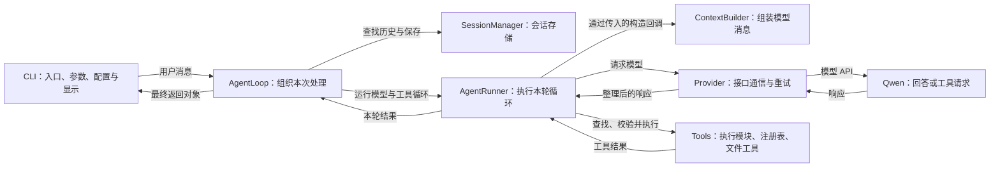
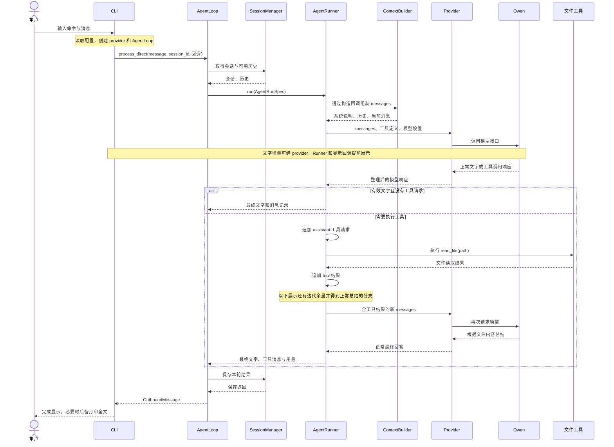
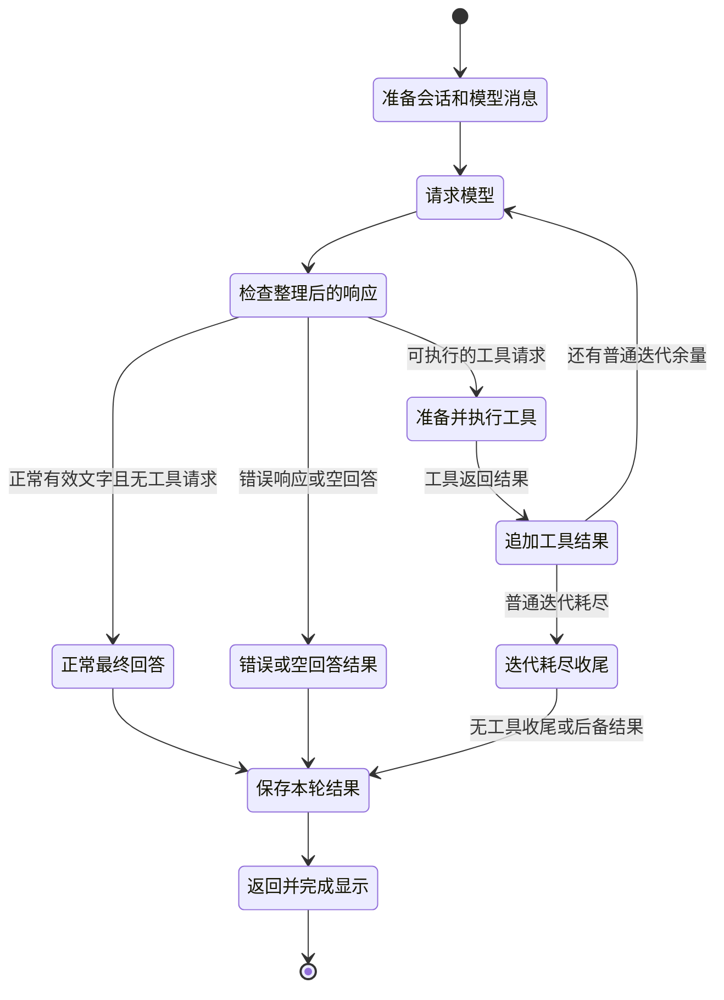

# Day16：Nanobot 的三张架构图

2026-10-13。对应 HKUDS/nanobot `v0.3.5`；本机源码位于 `C:\Users\LENOVO\Documents\Codex\2026-09-20\n\outputs\nanobot-0.3.5`。以下源码位置都相对于这个目录。

图以 Day15 的显式 `nanobot agent --message ...` 单次 CLI 路径为基础，展示普通回答与文件工具回传。已有真实示例是 Hello 和读取 meeting-notes.txt；今天只读源码，没有追加真实调用。图表准备不等于用户已独立掌握架构。

## 1. 模块图：每部分负责什么

依赖与职责的源码依据：

| 模块或关系 | 对应源码 |
|---|---|
| 安装命令入口 | `pyproject.toml:111` → `nanobot/cli/entry.py:71` |
| 显式单次命令路由 | `nanobot/cli/entry.py:90`、`:98`；`nanobot/cli/commands.py:472` |
| 参数与配置 | `nanobot/cli/agent.py:54`、`:82`；`nanobot/cli/runtime_config.py:117` |
| 创建 provider 与 AgentLoop | `nanobot/cli/agent.py:149`、`:171` |
| 把用户消息交给 AgentLoop | `nanobot/cli/agent.py:246`；`nanobot/agent/loop.py:2318` |
| 组织处理阶段 | `nanobot/agent/loop.py:1679` |
| 会话读取与保存 | `nanobot/agent/loop.py:1766`、`:1887`、`:2054`；`nanobot/session/manager.py:1740`、`:1786` |
| AgentLoop 交给 Runner | `nanobot/agent/loop.py:1170`；`nanobot/agent/runner.py:308` |
| 传入消息构造回调 | `nanobot/agent/loop.py:1120`、`:1177`；`nanobot/agent/context_governance.py:147` |
| 系统说明、历史和当前消息 | `nanobot/agent/context.py:276` |
| Runner 请求 provider | `nanobot/agent/runner.py:448`、`:984` |
| Qwen 接口位置 | `nanobot/providers/registry.py:557`；`nanobot/providers/openai_compat_provider.py:2129` |
| 工具准备、执行与回传 | `nanobot/agent/tools/registry.py:110`；`nanobot/agent/tools/execution.py:172`；`nanobot/agent/runner.py:544` |
| CLI 显示回调与后备打印 | `nanobot/cli/agent.py:250`、`:253`；`nanobot/cli/stream.py:187` |

AgentLoop 组织消息、会话与处理阶段；Runner 承担其中的模型/工具循环；provider 负责模型接口通信。单次 CLI 创建了 MessageBus，但正文通过 process_direct 进入，不先经过入站队列。

## 2. 时序图：一条消息怎样流转

时序图用逻辑模块表示参与者，省略 hook、EventSink、上下文治理等中间包装。返回箭头表示完整结果对象，不能理解为模型直到最后保存完成才首次显示文字。原代码还可能在正式请求前提前保存用户输入。

关键边的源码：

| 动作 | 对应源码 |
|---|---|
| 包装 InboundMessage | `nanobot/agent/loop.py:2345` |
| 进入处理阶段 | `nanobot/agent/loop.py:2374`、`:1679` |
| 调用 Runner 与初始消息构造 | `nanobot/agent/loop.py:1170`；`nanobot/agent/runner.py:310`；`nanobot/agent/context_governance.py:147` |
| 执行 read_file | `nanobot/agent/runner.py:512`；`nanobot/agent/tools/execution.py:172`；`nanobot/agent/tools/filesystem.py:294`、`:338` |
| 请求与结果分别追加 | `nanobot/agent/runner.py:497`、`:544` |
| 下一次模型请求 | `nanobot/agent/runner.py:579` → `:435` → `:448` |
| 正常结束与返回 | `nanobot/agent/runner.py:785`、`:789`、`:825` |
| 取得最终文字并保存 | `nanobot/agent/loop.py:1997`、`:2037`、`:2054` |

## 3. 阶段状态图：什么时候继续、什么时候结束

这是课堂级的主要阶段图，阶段标签不全是源码枚举。它展示普通用户消息的正常/工具/错误响应路径，省略启动错误、异常取消、内部事件注入、长度恢复和摘要压缩等分支。模型通信还包含 provider 重试；工具返回错误信息也可以作为 tool 结果交给模型解释，不能把工具成功直接等同于整次运行完成。

状态转换的源码：

| 转换 | 对应源码 |
|---|---|
| 准备、运行、保存、返回 | `nanobot/agent/loop.py:1679` |
| 普通迭代与模型请求 | `nanobot/agent/runner.py:435`、`:448` |
| 是否执行工具 | `nanobot/agent/runner.py:482`；`nanobot/providers/base.py:603` |
| 工具反馈与 continue | `nanobot/agent/runner.py:533`、`:544`、`:579` |
| 正常结束 | `nanobot/agent/runner.py:785`、`:789` |
| 错误与空回答 | `nanobot/agent/runner.py:715`、`:737` |
| 普通迭代耗尽 | `nanobot/agent/runner.py:791` |
| 可选的额外无工具收尾请求 | `nanobot/agent/runner.py:804`、`:1238`；`nanobot/session/turn_continuation.py:86` |

学习配置的 maxToolIterations=2 在 `nanobot/agent/loop.py:500` 映射为普通迭代上限。耗尽后的收尾可以额外请求模型，所以该数字不是所有 HTTP 请求的绝对上限。Day15 已运行的 Hello 和文件总结分别报告 1 和 2 次请求，没有触发耗尽；今天没有额外运行耗尽案例。
